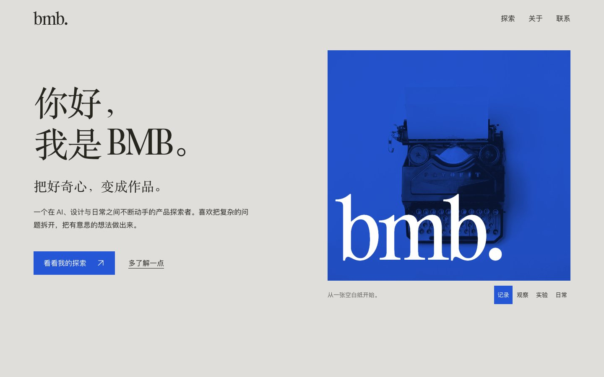

# BMB 个人网站的结构调整

[打开网站](https://bmbwaveforms.github.io/Ryan-Home/) · [查看源码](https://github.com/BMBWaveforms/Ryan-Home)

这个单页网站由我与 AI 工具协作完成，用来介绍目前关注的方向，并提供联系入口。这轮调整重点是阅读顺序和信息展开方式。

## 页面要完成什么

访客进入后，先知道我是谁、关注什么，再浏览四个探索方向，最后找到联系方式。当前内容主要是方向介绍，详细项目案例还在补充。

## 为什么调整结构

初版采用贯穿页面的图文分栏。调整后，双栏只保留在首屏，后面的探索区域使用完整内容宽度。这样四个方向的名称和摘要可以同时出现，访客不必逐个操作才能看懂主要内容。

手机上先显示姓名、介绍和入口，再出现配图。配图保留氛围作用，阅读顺序跟随访客需要知道的信息。

## 做了哪些取舍

- 四个探索方向的摘要始终可见，补充关注点使用原生折叠组件。
- 关于部分收成两段，减少与前文重复的兴趣标签。
- 联系区域保留邮件链接和复制操作，邮件链接在禁用 JavaScript 时仍可使用。
- 保留蓝灰配色与原有字体，集中修改结构和间距。

## 已检查到哪一步

2026 年 10 月 19 日的本地检查覆盖桌面、平板、手机和窄屏。记录中未发现页面横向溢出，四个探索方向的摘要均存在，联系邮箱可见；最终检查记录没有捕获到 JavaScript 异常，键盘首次聚焦可到达跳转链接并显示焦点边框。

这些记录说明相应页面状态经过检查，还不能证明访客更容易理解内容。后续需要观察真实访客能否快速找到项目与联系方式。

页面配图为有署名的氛围素材，不作为我的摄影或 AIGC 作品展示。

## 继续完善

把方向介绍逐步连接到具体项目，补充输入、过程和结果。GitHub 展示方法与源码，网站承接更完整的案例和视觉作品。

相关设计取舍见 [网站设计记录](https://github.com/BMBWaveforms/Ryan-Home/blob/main/DESIGN.md)。
